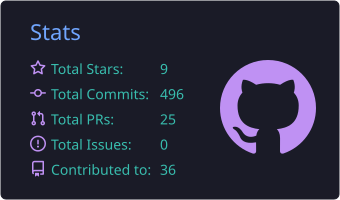
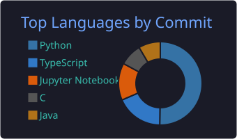
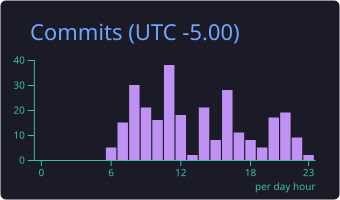
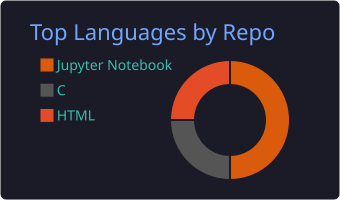

  

  

   

  

    
    
    
  

  <h3>I build RAG systems and LLM agents with LangGraph, ChromaDB and FastAPI, and apply data and optimization to real problems in Colombia.</h3>

<h2 align="center">
  
  <b> Connect & Collaborate </b>
  
</h2>

  
  

    

  💼 **Open to opportunities and collaborations** 
  🤝 Happy to team up on **AI projects, LLM applications and machine learning**

---

<h2 align="center">
  
  <b> About Me </b>
  
</h2>

🧠 Specialized in **Artificial Intelligence** and **Machine Learning** 
🤝 Strong **teamwork** and **communication**, a **fast learner** who adapts to new technologies 
🎯 Focused on innovative, efficient solutions that people can actually use

---

<h2 align="center">
  
  <b> Currently </b>
  
</h2>

  <table>
    <tr>
      <td align="center" width="33%">
        <h3>🧠 LLM Apps & Agents</h3>
        
<em>Building applications with LLMs and agentic workflows</em>

      </td>
      <td align="center" width="33%">
        <h3>🕸️ Graph RAG</h3>
        
<em>Pipelines for better retrieval and contextual reasoning</em>

      </td>
      <td align="center" width="33%">
        <h3>☁️ Google Cloud</h3>
        
<em>Learning to deploy scalable AI solutions</em>

      </td>
    </tr>
  </table>

---

<h2 align="center">
  <b> ⚡ Technology Arsenal ⚡ </b>
</h2>

<b>AI & ML</b> 

  
<b>Languages & Frameworks</b> 

  
<b>Data</b> 

  
<b>Tools</b> 

  

<b>Also:</b> LangChain · LangGraph · LangSmith · Langfuse · Pydantic · ChromaDB · Pinecone · Pandas · NumPy · Playwright · Pytesseract

---

<h2 align="center">
  
  <b> GitHub Analytics </b>
  
</h2>

  <!-- Generated daily by .github/workflows/profile-cards.yml -->
  
  
  
  

   

  

---

## 🚀 Featured Projects

| Project | What it does | Built with |
|---------|--------------|------------|
| 🏛️ [Agentic AI Practice](https://github.com/JhonEdisonPinto/Agentic-AI-practice) | A conversational RAG over **74 Colombian labor-law documents** (laws, decrees, rulings). A 5-node LangGraph pipeline classifies the query, calls specialized tools (e.g. severance calculations), retrieves, answers and verifies the result. | Python · LangGraph · ChromaDB · Gemini/Groq |
| 🥈 [Medcity Hackathon](https://github.com/JhonEdisonPinto/MedcityHackathon) | **2nd place at the Colombia 5.0 hackathon.** Geospatial data analysis and an interactive dashboard, paired with a LangGraph assistant backed by a Pinecone vector index. | Python · Streamlit · GeoPandas · LangGraph · Pinecone |
| 🥈 [Road Accidents Analytics](https://github.com/JhonEdisonPinto/MinTic-proyecto) | **2nd place in the Colombian Government's MinTIC program (Bogotá).** A web app that explores **2,800+ road-accident records in Palmira**, combining OCR of traffic law, statistics and Gemini-powered answers. | Python · Streamlit · Gemini API · OCR |
| ⚡ [Desk Assignment Optimizer](https://github.com/SamuelOrtizT/Challenge_ASOCIO25-optimizadores-SJS) | Team entry for the ASOCIO 2025 challenge: a MILP model that assigns employees to desks in hybrid workplaces, balancing preferences, team days and space usage. | Python · Pyomo · CBC |

---

  <h3>💡 Philosophy</h3>

  
<em>"Do everything with excellence and the best attitude possible. Quality and positivity make the difference."</em>

  
<em>"Working every day to give my family and me a better life through technology and innovation."</em>

---

  <h2>
    
    <b> Thank You for Visiting! </b>
    
  </h2>

  <picture>
    <source media="(prefers-color-scheme: dark)" srcset="https://raw.githubusercontent.com/JhonEdisonPinto/JhonEdisonPinto/output/github-contribution-grid-snake-dark.svg">
    <source media="(prefers-color-scheme: light)" srcset="https://raw.githubusercontent.com/JhonEdisonPinto/JhonEdisonPinto/output/github-contribution-grid-snake.svg">
    
  </picture>

  

